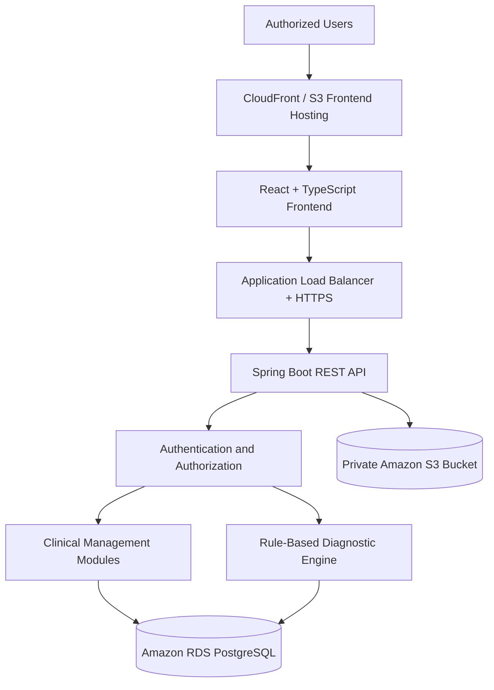

# Clinical Psychology Management System with Diagnostic Decision Support

A full-stack Electronic Health Record (EHR) and Clinical Decision Support System (CDSS) designed to support psychological care workflows, clinical documentation, patient management, and rule-based diagnostic decision support.

Built with Java 21, Spring Boot, React, TypeScript, PostgreSQL, and AWS, with an emphasis on secure data handling, role-based access control, maintainable architecture, and cloud infrastructure automation.

## Table of Contents

- [Overview](#overview)
- [Key Features](#key-features)
- [Screenshots](#screenshots)
- [Architecture](#architecture)
- [Technology Stack](#technology-stack)
- [Security](#security)
- [Diagnostic Decision Support](#diagnostic-decision-support)
- [Getting Started](#getting-started)
- [Cloud Infrastructure and Deployment](#cloud-infrastructure-and-deployment)
- [Engineering Decisions](#engineering-decisions)
- [Documentation](#documentation)
- [Project Status](#project-status)
- [Limitations and Future Improvements](#limitations-and-future-improvements)
- [Academic Context](#academic-context)
- [License](#license)

## Overview

This project addresses the need for an integrated system to manage clinical information and support psychological care workflows within a clinical psychology setting.

The application combines electronic health record management with a deterministic, rule-based clinical decision support engine. It is designed to help organize patient information, maintain clinical documentation, manage appointments and sessions, and provide diagnostic suggestions based on documented clinical criteria.

The system follows a modular monolith architecture, separating application responsibilities while maintaining a single backend deployment. This approach supports maintainability and clear module boundaries without introducing the operational complexity of a distributed microservices architecture.

The project also incorporates cloud infrastructure automation and containerized deployment practices to demonstrate the application of software engineering principles throughout the development lifecycle.

## Key Features

### Patient and Clinical Record Management

- Patient registration and management.
- Clinical record and medical history management.
- Clinical documentation and psychological evaluation workflows.
- Management of appointments and clinical sessions.
- Secure handling of clinical documents.

### Clinical Decision Support

- Diagnostic catalog organized by diagnostic categories.
- Deterministic rules based on explicitly modeled diagnostic criteria.
- Diagnostic suggestions based on documented clinical information.
- Professional review and confirmation of diagnostic suggestions.
- Support for evaluating concordance between system suggestions and professional decisions.

### User and Access Management

- Authentication using JSON Web Tokens (JWT).
- Role-based access control and permission management.
- Server-side authorization for protected operations.
- Patient assignment management for psychologists.
- Administrative oversight and assignment management for authorized coordinators.

### Reporting and Coordination

- Operational reporting for clinical coordination.
- Patient and appointment monitoring.
- Session activity and cancellation reporting.
- Management visibility based on user responsibilities and permissions.

*Feature availability depends on the current implementation. Refer to the project documentation for further details.*

## Screenshots

Screenshots will be added as the application interface is finalized and representative workflows are available for demonstration.

<!-- Replace these placeholders with actual screenshots captured from the application. -->
<!-- Example:  -->

| Application Area | Description |
| --- | --- |
| Dashboard | Overview of relevant clinical activities and system functionality. |
| Patient Management | Patient information and clinical record workflows. |
| Clinical Sessions | Clinical documentation and session management. |
| Diagnostic Support | Rule-based diagnostic suggestions and professional review. |
| Coordination | Administrative oversight and operational reporting. |

Screenshots must use synthetic or appropriately anonymized data. No identifiable patient information, credentials, tokens, or confidential clinical records should be published.

## Architecture

The system uses a modular monolith backend exposed through REST APIs and a separate web frontend. PostgreSQL provides relational data persistence, while Amazon S3 is used for clinical document storage.

### High-Level Architecture



*This diagram represents the intended deployment architecture. Refer to the deployment documentation for the resources currently provisioned and operational.*

### Architectural Characteristics

- **Modular monolith:** Organized application responsibilities within a single backend deployment.
- **REST API:** Separates frontend presentation from backend business logic.
- **Relational persistence:** Uses PostgreSQL and database migrations to manage schema evolution.
- **Layered backend:** Separates controllers, services, persistence, and data-transfer concerns.
- **Cloud infrastructure as code:** Uses AWS CDK to define and manage infrastructure.
- **Containerized backend:** Uses Docker and Amazon ECS Fargate for application deployment.

For more information, see [Architecture Documentation](docs/ARCHITECTURE.md).

## Technology Stack

| Area | Technologies |
| --- | --- |
| Backend Language | Java 21 |
| Backend Framework | Spring Boot |
| API and Persistence | Spring MVC, Spring Data JPA, Hibernate |
| Security | Spring Security, JWT, role-based authorization |
| Frontend | React, TypeScript, Vite |
| UI Components | Material UI |
| Database | PostgreSQL |
| Database Migrations | Flyway |
| Build Tools | Maven, npm |
| Document Storage | Amazon S3 |
| Containerization | Docker |
| Container Registry | Amazon ECR |
| Application Hosting | Amazon ECS Fargate |
| Database Hosting | Amazon RDS for PostgreSQL |
| Networking and HTTPS | Amazon VPC, Application Load Balancer, AWS Certificate Manager |
| Infrastructure as Code | AWS CDK |
| CI/CD | GitHub Actions |
| Frontend Hosting | Amazon S3 and CloudFront, when deployed |

## Security

Security is an important design consideration because the application handles sensitive clinical information.

The implementation incorporates or is designed around the following controls:

- JWT-based authentication for protected API access.
- Server-side role and permission enforcement.
- Authorization checks for patient assignments and protected clinical operations.
- Encryption of designated sensitive database fields.
- HTTPS for externally exposed application traffic.
- Private networking for database resources.
- Restricted access to clinical documents stored in Amazon S3.
- Managed application secrets and environment-specific configuration.

Security controls must be evaluated in the context of the actual deployed configuration. The presence of an individual control does not, by itself, establish that the entire application is production-ready or compliant with a particular regulatory framework.

## Diagnostic Decision Support

The Clinical Decision Support System implements a deterministic, rule-based approach to diagnostic suggestions.

The engine evaluates documented clinical information against explicitly modeled diagnostic criteria and returns a suggestion when the applicable rules are satisfied.

The intended workflow is:

1. The professional documents relevant clinical information.
2. The system evaluates the applicable diagnostic rules.
3. The system presents a suggestion when a rule matches.
4. The professional reviews the suggestion and confirms it or selects another diagnosis.
5. The resulting professional decision can be compared with the system's original suggestion to evaluate diagnostic concordance.

The decision support engine is intended to assist clinical reasoning, not replace professional judgment.

The system does not rely on machine learning or probabilistic predictions for its diagnostic rule evaluation. Its behavior depends on the quality and completeness of the modeled criteria and the clinical information entered.

Diagnostic concordance is an evaluation measure, not evidence by itself of clinical accuracy or effectiveness.

## Getting Started

The project can be developed locally using the backend, frontend, and a PostgreSQL database.

### Prerequisites

- Java Development Kit (JDK) 21.
- Node.js and npm, using a version compatible with the frontend dependencies.
- PostgreSQL.
- Git.
- Docker, if running the backend in a container.
- AWS CLI and appropriate AWS credentials, only for workflows that require AWS access.

### Clone the Repository

```bash
git clone https://github.com/gioescobar87/ehr-cdss-psychology-management-system.git

cd ehr-cdss-psychology-management-system
```

### Backend

Navigate to the backend project:

```bash
cd backend/clinical-system
```

Configure the required environment variables and database connection using the project's development configuration.

On Windows, start the application with:

```powershell
.\mvnw.cmd spring-boot:run
```

On Linux or macOS, use:

```bash
./mvnw spring-boot:run
```

### Frontend

From the repository root, navigate to the frontend directory:

```bash
cd frontend
```

Install dependencies and start the development server:

```bash
npm install
npm run dev
```

The exact frontend directory, required environment variables, database initialization, and available test commands should be verified against the current repository configuration before using these instructions as a reproducible setup guide.

For complete prerequisites, configuration details, database setup, and troubleshooting, see [Development Documentation](docs/DEVELOPMENT.md).

## Cloud Infrastructure and Deployment

The project uses AWS services to support a containerized backend, relational database persistence, and secure document storage.

The infrastructure design includes:

- Amazon VPC for network isolation.
- Amazon ECS Fargate for backend container execution.
- Amazon ECR for container image storage.
- Amazon RDS for PostgreSQL.
- Amazon S3 for clinical documents.
- Application Load Balancer and AWS Certificate Manager for HTTPS access.
- AWS CDK for infrastructure provisioning.

GitHub Actions is used for CI/CD automation, with the intended deployment workflow covering backend validation, container image publication, and application deployment.

Frontend hosting and delivery through Amazon S3 and CloudFront are part of the planned deployment architecture and should be considered operational only after the corresponding resources and delivery workflow have been deployed and verified.

Infrastructure provisioning and application deployment are separate concerns. A provisioned AWS resource does not necessarily mean the application workflow that depends on it is fully operational.

For deployment instructions, environment configuration, operational verification, and rollback procedures, see [Deployment Documentation](docs/DEPLOYMENT.md).

## Engineering Decisions

Several engineering decisions shape the system's implementation.

### Modular Monolith

The backend is organized into distinct application responsibilities while retaining a single deployment unit. This provides separation of concerns and simplifies deployment and debugging without the additional infrastructure and operational overhead associated with microservices.

### Explicit Authorization

Access control is enforced on the server side rather than relying exclusively on frontend navigation or visibility. Patient assignment rules are especially important because clinical records must only be accessible to appropriately authorized users.

### Deterministic Clinical Rules

The diagnostic engine uses explicit rules to make its decision process reproducible and inspectable. This avoids presenting probabilistic model outputs as deterministic clinical conclusions and allows the system's recommendations to be evaluated against professional decisions.

### Infrastructure as Code

AWS CDK defines cloud resources in code, making infrastructure configuration easier to review, reproduce, and maintain than a workflow based entirely on manual console changes.

### Separation of Clinical Data and Documents

Structured clinical information is persisted in PostgreSQL, while clinical documents are stored in Amazon S3. This separates relational data management from document storage and allows each resource to have its own access controls and lifecycle considerations.

## Documentation

The following documents provide additional technical details.

| Document | Description |
| --- | --- |
| [Architecture](docs/ARCHITECTURE.md) | System components, module boundaries, data flows, and architectural decisions. |
| [Development Guide](docs/DEVELOPMENT.md) | Local setup, configuration, database initialization, and testing. |
| [Deployment Guide](docs/DEPLOYMENT.md) | AWS infrastructure, deployment workflows, verification, and rollback. |
| [Feature Reference](docs/FEATURES.md) | Functional modules, clinical workflows, and access rules. |
| [Security](docs/SECURITY.md) | Security controls, limitations, and reporting of vulnerabilities. |

These documents should be added as their contents are completed.

## Project Status

This is an actively developed software engineering and graduation project.

The repository demonstrates full-stack application development, backend API design, relational database management, security implementation, deterministic clinical decision support, containerization, and cloud infrastructure automation.

The completion status of individual modules, automated workflows, and deployment components should be verified against the current implementation. The project should not be considered clinically validated or production-ready solely because its infrastructure has been provisioned.

## Limitations and Future Improvements

Potential areas for continued development include:

- Expanding automated unit, integration, and end-to-end test coverage.
- Completing and validating the automated deployment pipeline.
- Strengthening security monitoring, auditability, and operational alerting.
- Testing backup restoration and disaster recovery procedures.
- Improving deployment observability and operational documentation.
- Expanding the modeled diagnostic criteria and validating their implementation against authoritative clinical references.
- Evaluating diagnostic concordance using a documented methodology and appropriate professional review.

Future improvements will be prioritized according to clinical requirements, security considerations, and the project's evaluation objectives.

## Academic Context

This project is developed as part of a Systems Engineering graduation project at Universidad Mariano Gálvez de Guatemala.

It applies software engineering principles to the design and implementation of an integrated clinical information management system with deterministic diagnostic decision support.

## License

No license has been specified yet. Unless a license is added to the repository, the project's reuse and redistribution permissions should not be assumed.

