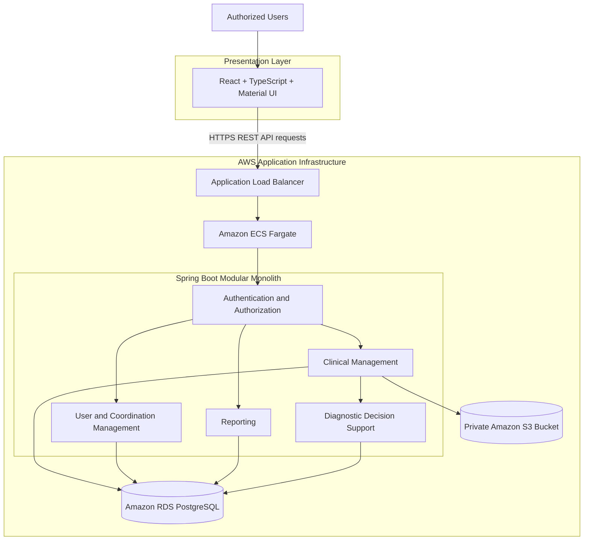
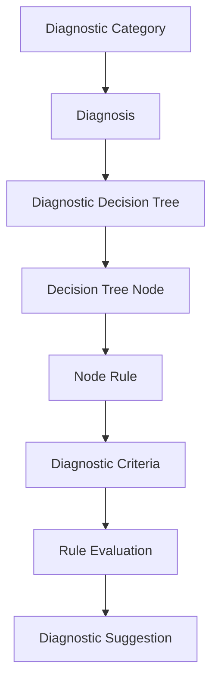

# System Architecture

## 1. Overview

The Clinical Psychology Management System is a full-stack Electronic Health Record (EHR) and Clinical Decision Support System (CDSS) designed to support clinical documentation, patient management, psychological care workflows, and rule-based diagnostic decision support.

The application follows a **modular monolith architecture**. The frontend and backend are separate applications, while the backend organizes business functionality into cohesive modules deployed as a single application.

The architecture prioritizes maintainability, controlled access to sensitive clinical information, reproducible infrastructure provisioning, and a deployment model appropriate for the project's scope.

## 2. Architectural Principles

The system follows these principles:

- **Separation of concerns:** Presentation, business logic, persistence, and infrastructure responsibilities are separated.
- **Modularity:** Clinical and administrative capabilities are organized into distinct functional modules.
- **Server-side security:** Authentication and authorization decisions are enforced by the backend.
- **Data protection:** Sensitive information and clinical documents require appropriate encryption and access controls.
- **Deterministic decision support:** Diagnostic suggestions are generated through explicitly modeled rules rather than machine learning or probabilistic inference.
- **Infrastructure as code:** AWS resources are defined and managed through AWS CDK.
- **Reproducibility:** Database schema changes and application builds are managed through version-controlled tooling.

## 3. High-Level Architecture

The diagram illustrates the logical application architecture and intended AWS deployment model. Actual frontend hosting and delivery resources must be verified against the deployed infrastructure.

## 4. Technology Stack

### Backend

| Technology | Responsibility |
| --- | --- |
| Java 21 | Backend programming language |
| Spring Boot | Application configuration and service runtime |
| Spring MVC | REST API endpoints |
| Spring Security | Authentication and authorization |
| Spring Data JPA | Persistence abstraction |
| Hibernate | Object-relational mapping |
| Flyway | Version-controlled database migrations |
| Maven | Dependency management and build automation |

### Frontend

| Technology | Responsibility |
| --- | --- |
| React | User interface and component composition |
| TypeScript | Static type checking |
| Vite | Frontend development server and build tooling |
| Material UI | Interface components and styling |

### Data and Infrastructure

| Technology | Responsibility |
| --- | --- |
| PostgreSQL | Relational persistence |
| Docker | Application containerization |
| Amazon ECR | Container image registry |
| Amazon ECS Fargate | Managed container execution |
| Amazon RDS | Managed PostgreSQL database |
| Amazon S3 | Clinical document storage |
| Amazon VPC | Network isolation |
| Application Load Balancer | Backend traffic routing |
| AWS Certificate Manager | TLS certificate management |
| AWS CDK | Infrastructure as code |
| GitHub Actions | CI/CD automation |

## 5. Backend Architecture

The backend is organized around a layered architecture within a modular monolith.

### 5.1 Presentation Layer

The presentation layer exposes REST endpoints through Spring MVC controllers.

Responsibilities include:

- Receiving and validating HTTP requests.
- Enforcing endpoint-level security requirements.
- Mapping requests and responses through data-transfer objects (DTOs).
- Delegating business operations to application services.
- Returning appropriate HTTP status codes and response bodies.

Controllers should not contain complex business logic or directly manage persistence operations.

### 5.2 Application and Business Logic Layer

The service layer coordinates application workflows and enforces business rules.

Examples include:

- Patient registration and management.
- Clinical history management.
- Appointment and session workflows.
- User and role administration.
- Patient assignment management.
- Diagnostic rule evaluation.
- Coordination reporting.

Where applicable, service interfaces and implementations separate application contracts from implementation details.

### 5.3 Persistence Layer

Repositories use Spring Data JPA and Hibernate to interact with PostgreSQL.

The persistence layer is responsible for database access, while Flyway manages schema evolution through version-controlled migration scripts.

Business rules and authorization decisions should not depend exclusively on frontend behavior or database visibility.

### 5.4 Data Transfer and Mapping

DTOs define the data exposed by API endpoints. Mapping between DTOs and persistence entities helps separate the public API contract from the internal database model.

This approach also allows request validation and response shaping without exposing every entity field to clients.

## 6. Authentication and Authorization

The application uses JWT-based authentication with database-backed refresh-token management.

The security architecture includes:

- Authentication of application users.
- Access-token validation for protected requests.
- Refresh-token persistence and lifecycle management.
- Role, permission, and module-based access control.
- Server-side authorization for sensitive operations.
- Assignment-aware access restrictions for clinical records.

### Role-Based Access Control

The application models users, roles, permissions, modules, and their relationships to control access to application functionality.

The intended responsibilities include:

| Role | General responsibility |
| --- | --- |
| Administrator | System and user administration according to assigned permissions |
| Coordinator | Clinical coordination, authorized oversight, and patient assignment management |
| Psychologist | Assigned patient management and authorized clinical workflows |

The exact permissions are determined by the configured roles and permission assignments.

### Patient Assignment Authorization

Patient access is not determined solely by whether a user has authenticated successfully.

Psychologists must be authorized to access the relevant patient based on the application's assignment rules. Coordinators with the appropriate permissions can oversee assignments and manage reassignment workflows.

Assignment history is retained to support traceability of patient allocation changes.

## 7. Clinical Data and Document Storage

The architecture separates structured clinical information from stored documents.

### PostgreSQL

PostgreSQL stores structured application data, including patient records, clinical workflows, diagnostic catalogs, user information, and related entities.

Relational constraints and application-level validation help maintain data integrity.

### Amazon S3

Amazon S3 stores clinical documents separately from the relational database.

The intended storage configuration includes private bucket access, encryption, versioning, and restricted access through authorized application workflows.

Document access must be enforced through the backend and appropriate AWS permissions rather than by exposing unrestricted bucket objects.

### Sensitive Data Encryption

Designated sensitive database fields use application-level encryption with AES-GCM and an initialization vector (IV).

The implementation uses a JPA attribute converter to integrate field encryption with persistence operations.

This mechanism is distinct from encryption at rest provided by the underlying database or storage service. Encryption-key management, backup protection, access control, and transport security remain separate security responsibilities.

## 8. Clinical Decision Support System

The CDSS uses a deterministic rule engine to evaluate documented clinical information against modeled diagnostic criteria.

It is designed to provide suggestions for professional review rather than autonomously establish diagnoses.

### 8.1 Rule Model

The diagnostic knowledge model is organized around the following relationships:

This model separates the diagnostic catalog from the rules used to evaluate documented clinical information.

The diagram represents the logical rule model. The exact relationships and execution sequence depend on the implemented schema and service logic.

### 8.2 Evaluation Workflow

The intended workflow is:

1. The professional documents relevant clinical information.
2. The application evaluates applicable diagnostic rules.
3. When a rule matches, the system presents a diagnostic suggestion.
4. The professional reviews the suggestion and decides whether to confirm it or select another diagnosis.
5. The original system suggestion and the professional's decision can be compared for concordance evaluation.

When no rule matches, the system should not fabricate a suggestion.

### 8.3 Deterministic Behavior

The engine uses explicit conditions and rules rather than machine learning, natural language processing, fuzzy logic, or probabilistic prediction.

Given the same applicable rules and equivalent input data, the evaluation is intended to produce reproducible results.

The reliability of the output depends on the completeness of the modeled criteria, the correctness of the implementation, and the quality of the documented information.

### 8.4 Diagnostic Concordance

Diagnostic concordance measures whether the system's original suggestion matches the diagnosis confirmed by the psychologist.

This measure is distinct from other forms of diagnostic consistency evaluated internally by the rule engine.

Concordance is an evaluation measure and should not be interpreted as proof of clinical accuracy, diagnostic validity, or improved patient outcomes.

## 9. Cloud Deployment Architecture

The backend deployment uses AWS managed services.

The infrastructure design includes:

- A VPC distributed across multiple Availability Zones.
- Public subnets for externally accessible infrastructure where required.
- Private subnets for application workloads.
- Isolated subnets for the relational database.
- An Application Load Balancer for HTTPS traffic.
- An ECS Fargate service for the backend container.
- Amazon ECR for backend images.
- Amazon RDS for PostgreSQL.
- Amazon S3 for clinical document storage.
- AWS Secrets Manager for application and database secrets.
- Amazon CloudWatch for application logs and operational monitoring.

The deployed environment must be checked independently to confirm which components are active and correctly configured.

### Network Boundaries

The intended traffic flow is:

1. External clients connect through the public HTTPS endpoint.
2. The load balancer forwards requests to the backend service.
3. The backend accesses the database through private networking.
4. The backend accesses clinical document storage through authorized AWS permissions.
5. The database is not exposed directly to the public internet.

Security groups and IAM policies should restrict communication to the minimum required ports, resources, and operations.

## 10. CI/CD and Infrastructure as Code

AWS CDK defines infrastructure resources in code, allowing changes to be reviewed and deployed through a repeatable process.

The intended CI/CD workflow uses GitHub Actions and short-lived AWS credentials through OpenID Connect (OIDC), avoiding the need for long-lived AWS access keys in GitHub repository secrets.

The backend delivery workflow is designed to cover:

1. Triggering on relevant repository changes or manual execution.
2. Building and testing the backend.
3. Building a Docker image.
4. Publishing the image to Amazon ECR.
5. Updating the ECS service.
6. Verifying deployment health and handling failed deployments.

The frontend delivery workflow is intended to build the React application, publish static assets, and invalidate the CloudFront cache when the relevant resources are configured.

Refer to the deployment documentation for the current workflow definitions and verified operational status.

## 11. Design Trade-offs

### Modular Monolith Instead of Microservices

A modular monolith provides clear functional boundaries while reducing deployment complexity, inter-service communication, distributed tracing requirements, and operational overhead.

It is appropriate for a system whose functional modules are related and whose deployment scale does not currently justify independent microservices.

### Managed Cloud Services

ECS Fargate, RDS, and S3 reduce the need to manage container hosts, database operating systems, and document-storage infrastructure directly.

The trade-off includes ongoing cloud costs, service-specific operational constraints, and the need to configure IAM, networking, monitoring, and recovery correctly.

### Deterministic Rules Instead of Machine Learning

Explicit rules make the diagnostic evaluation process inspectable and reproducible.

However, rule-based evaluation does not eliminate the need for clinical review, careful modeling, testing, and validation against appropriate clinical references.

## 12. Further Reading

- [Project README](../README.md)
- [Development Guide](DEVELOPMENT.md)
- [Deployment Guide](DEPLOYMENT.md)
- [Feature Reference](FEATURES.md)
- [Security Documentation](SECURITY.md)
