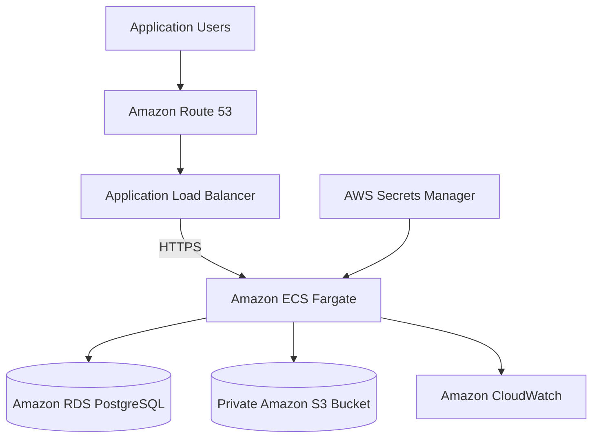

# Deployment Guide

## 1. Overview

The Clinical Psychology Management System uses AWS managed services and infrastructure as code to support a containerized backend, relational database persistence, and clinical document storage.

The deployment architecture is designed to provide secure network boundaries, repeatable infrastructure provisioning, HTTPS access, and an automated application delivery workflow.

The primary infrastructure is defined using AWS Cloud Development Kit (CDK). GitHub Actions is used to automate application validation and deployment through short-lived AWS credentials obtained using OpenID Connect (OIDC).

This document describes the deployment architecture, prerequisites, infrastructure resources, deployment workflow, and operational verification procedures.

**Important:** Provisioned infrastructure does not necessarily mean that every application component or deployment workflow is operational. Verify the current AWS resources and CI/CD workflow results before treating any environment as fully deployed.

## 2. Deployment Architecture

The production environment uses the following AWS services:

| Service | Responsibility |
| --- | --- |
| Amazon VPC | Network isolation and subnet organization |
| Amazon ECS Fargate | Backend container execution |
| Amazon ECR | Backend container image registry |
| Amazon RDS for PostgreSQL | Relational database hosting |
| Amazon S3 | Clinical document storage |
| Application Load Balancer | HTTPS traffic routing |
| AWS Certificate Manager | TLS certificate management |
| Amazon Route 53 | DNS hosting and routing |
| AWS Secrets Manager | Application and database secrets |
| Amazon CloudWatch | Container logs and operational monitoring |
| AWS CDK | Infrastructure provisioning and updates |
| GitHub Actions | CI/CD automation |

The intended traffic flow is:



The diagram represents the intended backend architecture. Frontend hosting through Amazon S3 and CloudFront should be documented as operational only after its resources and deployment workflow have been verified.

## 3. Prerequisites

Before deploying the application, ensure that the following tools and resources are available.

### Local Tools

- Git.
- Java Development Kit (JDK) 21.
- Node.js and npm for frontend builds.
- Docker.
- AWS CLI.
- AWS CDK CLI.
- Node.js and npm for CDK execution, if required by the infrastructure project.
- Appropriate AWS permissions.

### AWS Requirements

The deployment requires:

- An AWS account and an appropriately configured deployment identity.
- An AWS region consistent with the infrastructure configuration.
- Permissions to manage the required CloudFormation, networking, ECS, ECR, RDS, S3, IAM, ACM, Route 53, and Secrets Manager resources.
- Access to the project's container registry and deployment resources.
- A registered domain and DNS access for public HTTPS endpoints.

Use a dedicated deployment identity with least-privilege permissions. Do not use the AWS root account for routine deployment operations.

## 4. Repository Structure

The deployment-related code is maintained separately from the application modules.

The relevant project directories include:

```text
ehr-cdss-psychology-management-system/
├── backend/
│   └── clinical-system/
├── frontend/
├── infrastructure/
├── docs/
│   ├── ARCHITECTURE.md
│   ├── DEVELOPMENT.md
│   ├── DEPLOYMENT.md
│   └── FEATURES.md
└── .github/
    └── workflows/
```

Verify the exact directory names and workflow filenames against the current repository before running commands.

## 5. Infrastructure Provisioning

The infrastructure project uses AWS CDK to define and deploy AWS resources through AWS CloudFormation.

The stack is named `ClarityEhrProductionStack`.

### 5.1 Network Infrastructure

The VPC is configured to distribute resources across multiple Availability Zones.

The network design includes:

- Public subnets for internet-facing infrastructure.
- Private subnets with outbound connectivity for application workloads.
- Isolated subnets for the relational database.
- Security groups controlling traffic between resources.

The database should remain inaccessible directly from the public internet.

### 5.2 Container Registry

Amazon ECR stores the backend Docker images.

The registry configuration includes image scanning on push, immutable image tags, and a lifecycle policy to limit retained images.

Immutable tags help prevent an existing image tag from being silently overwritten. Each deployment should use a uniquely identifiable image tag or digest.

### 5.3 Backend Runtime

Amazon ECS Fargate runs the backend container without requiring direct management of EC2 container hosts.

The service is configured with:

- A dedicated ECS cluster.
- A Fargate task definition.
- Application and task execution IAM roles.
- Environment-specific application configuration.
- Secrets injected through supported AWS mechanisms.
- CloudWatch log integration.
- A load balancer target group.
- A container health-check endpoint.
- Deployment rollback settings.

The service's CPU, memory, desired task count, and deployment settings should be verified against the active CDK configuration.

### 5.4 Database

Amazon RDS hosts the PostgreSQL database.

The intended configuration includes:

- PostgreSQL 16.
- A database named `clinical_system`.
- Private database networking.
- Automated backups.
- A managed database secret.
- Storage encryption and controlled access.

The currently configured development and production settings must be reviewed before deployment. A small instance and a single database instance without Multi-AZ availability are appropriate only when their availability and recovery limitations are understood.

Database backups must be supplemented by tested restoration procedures.

### 5.5 Document Storage

Amazon S3 stores clinical documents separately from relational application data.

The bucket is configured for private access, versioning, encryption, and retention of stored objects.

Application access should use restricted IAM permissions and the configured AWS SDK integration.

Do not make the bucket public to resolve application access errors.

### 5.6 DNS and HTTPS

Amazon Route 53 manages DNS records for the application endpoints.

AWS Certificate Manager supplies the TLS certificate used by the public API endpoint.

The intended API hostname is:

`api.clarityehr.app`

The Application Load Balancer accepts HTTP traffic for redirection to HTTPS and forwards HTTPS requests to the backend target group.

The certificate must be issued and valid in the AWS region required by the regional load balancer. DNS records, certificate status, listeners, and security groups should be checked before considering HTTPS operational.

## 6. Application Configuration and Secrets

Production configuration must be kept separate from local development configuration.

The backend uses environment-specific Spring configuration and obtains sensitive values through managed secret storage and the deployment environment.

Relevant settings may include:

- Active Spring profile.
- Database connection configuration.
- JWT signing configuration.
- JWT issuer and token expiration settings.
- Frontend origin allowed by CORS.
- AWS region and S3 bucket.
- SMTP configuration, when email functionality is enabled.

The application uses the `prod` Spring profile for the production deployment.

Verify the required environment-variable names against the actual application configuration. Do not substitute placeholder names for properties the application does not recognize.

### Secret Management

AWS Secrets Manager is used for application and database secrets.

Recommended practices include:

- Never commit secrets to Git.
- Avoid embedding secrets in Docker images.
- Restrict secret access to the IAM roles that require it.
- Avoid printing secrets in application logs.
- Rotate secrets using a process compatible with application configuration and session behavior.
- Keep local `.env` files out of version control.

JWT signing keys must be treated as sensitive production secrets. Rotating signing keys may invalidate existing tokens, so rotation should be planned accordingly.

## 7. Backend Deployment

The backend deployment workflow builds and publishes a Docker image to Amazon ECR and updates the ECS service.

### 7.1 Build and Test

From the backend directory:

```powershell
.\mvnw.cmd clean verify
```

Run this command on Windows. On Linux or macOS, use the corresponding `./mvnw` executable.

Resolve test failures before publishing a new image.

### 7.2 Build the Docker Image

Build the image using the repository's actual Dockerfile and build context.

For example, if the Dockerfile is located at the backend project root:

```bash
docker build -t clarityehr-backend:local .
```

Run the command from the directory containing the Dockerfile.

Before publishing, confirm that the image contains the expected application build and does not include credentials, local configuration files, or development-only artifacts.

### 7.3 Publish to Amazon ECR

Authenticate Docker to the intended ECR registry using the AWS CLI.

```bash
aws ecr get-login-password --region us-east-2
```

The command returns an authentication password. It must be supplied to Docker's login operation through a pipeline rather than copied into documentation or stored in source control.

Use the registry URI returned by AWS for the target account and region.

Assign a unique deployment tag, authenticate to ECR, tag the image, and push it to the registry.

Because repository tags are immutable, do not attempt to reuse an existing tag that has already been published.

### 7.4 Update the ECS Service

The deployment process updates the ECS task definition and service to use the newly published image.

After the update:

1. Confirm that the ECS service has completed its deployment.
2. Verify that the expected number of tasks is running.
3. Inspect stopped tasks and container logs if a task fails.
4. Verify the load balancer target health.
5. Test the backend health endpoint over HTTPS.
6. Test representative API requests that do not expose sensitive data.

The ECS deployment circuit breaker is configured to roll back certain failed deployments. Confirm the actual service events and task definition revision rather than assuming a rollback occurred.

## 8. Frontend Deployment

The frontend is a React and TypeScript application built using Vite.

The intended production delivery architecture uses Amazon S3 for static asset storage and Amazon CloudFront for distribution.

A complete deployment workflow should:

1. Install frontend dependencies using the committed lockfile.
2. Run available linting and type checks.
3. Build the production application.
4. Configure the production API endpoint.
5. Upload the generated assets to the intended S3 origin.
6. Apply the required cache-control policies.
7. Invalidate the CloudFront cache when necessary.
8. Verify that the frontend loads and can reach the API.

The frontend must use the correct production API URL and must not include private credentials.

Confirm that the CloudFront distribution, origin access controls, DNS records, TLS certificate, and deployment workflow exist before treating this deployment process as operational.

## 9. GitHub Actions and OIDC

GitHub Actions automates build, validation, and deployment tasks.

The backend workflow is designed to build and test the application, publish the container image to ECR, and update ECS.

The intended AWS authentication mechanism uses GitHub's OIDC identity provider and an AWS IAM role.

This avoids maintaining long-lived AWS access keys in GitHub repository secrets.

### Security Requirements

- Grant the workflow only the IAM permissions required for its deployment responsibilities.
- Restrict the role trust policy to the intended GitHub organization or user, repository, and branch or environment.
- Use `id-token: write` only in workflows that require OIDC authentication.
- Keep `contents: read` unless additional repository permissions are necessary.
- Do not expose secrets in workflow logs.
- Pin third-party GitHub Actions to reviewed versions or commit SHAs according to the project's security policy.
- Review workflow changes before merging them into the deployment branch.

The frontend and backend deployment workflows should be evaluated independently because they publish different artifacts and update different AWS resources.

## 10. Deployment Verification

Use the following checklist after each production deployment.

### Backend

- [ ] The ECS service deployment has completed.
- [ ] The expected task count is running.
- [ ] The target group reports healthy targets.
- [ ] The API responds over HTTPS.
- [ ] The application logs contain no startup errors.
- [ ] Database connectivity is functioning.
- [ ] Required S3 operations work through authorized application workflows.
- [ ] Authentication and authorization behave as expected.

### HTTPS and DNS

- [ ] The API hostname resolves to the intended load balancer.
- [ ] The ACM certificate is issued and valid.
- [ ] HTTPS requests succeed.
- [ ] HTTP requests redirect to HTTPS.
- [ ] The load balancer does not expose unintended ports.

### Frontend

- [ ] The frontend assets load successfully.
- [ ] The configured API URL points to the production backend.
- [ ] CORS permits only the intended frontend origins.
- [ ] Authentication and session workflows work.
- [ ] CloudFront serves the expected asset versions, if deployed.

### Security

- [ ] The database is not publicly accessible.
- [ ] S3 clinical documents remain private.
- [ ] Secrets are not exposed in logs or source control.
- [ ] IAM permissions and security groups follow least privilege.
- [ ] Synthetic test data is used for verification.

## 11. Rollback and Recovery

Rollback procedures depend on the type of change.

### Application Rollback

For a failed backend release:

1. Identify the previous known-good task definition revision and image digest.
2. Confirm that the previous image is still available in ECR.
3. Restore the service to the known-good revision through the approved deployment process.
4. Verify service stability and target health.
5. Review logs and deployment events to identify the cause.

Do not assume that reverting an application image reverses database migrations.

### Infrastructure Rollback

AWS CDK deploys infrastructure through CloudFormation. Review the CloudFormation stack events and change set before attempting to recover from a failed infrastructure update.

Do not delete production resources as a troubleshooting shortcut.

Resources configured for retention or snapshot-based removal may preserve data, but retention settings alone do not guarantee that the data can be restored successfully.

### Database Recovery

Database recovery should use the configured RDS backups or snapshots and a documented restoration procedure.

Before restoring a database:

- Identify the required recovery point.
- Confirm the target database and application compatibility.
- Assess the impact of data loss since the recovery point.
- Preserve the existing database when required for investigation.
- Verify application connectivity and data integrity after restoration.

Database recovery should be tested in a controlled environment before it is needed during an incident.

## 12. Operational Monitoring

Amazon CloudWatch provides application logs and operational visibility.

Recommended monitoring includes:

- ECS task failures and restarts.
- Application startup and runtime errors.
- Load balancer target health.
- Database CPU, storage, connections, and availability.
- API latency and error rates.
- Unexpected increases in resource utilization.
- Deployment failures and rollback events.

Logs should support troubleshooting without exposing patient information, credentials, tokens, or other sensitive values.

Additional alerting, audit logging, and security monitoring should be configured and tested according to operational requirements.

## 13. Cost Management

The deployment uses managed AWS services that may incur charges even when the application receives little traffic.

Important cost considerations include:

- ECS Fargate task runtime.
- Amazon RDS instance and storage costs.
- NAT Gateway hourly and data-processing charges.
- Application Load Balancer hourly and usage charges.
- CloudWatch log ingestion and retention.
- S3 storage and requests.
- CloudFront data transfer and requests.
- Public IPv4 address charges, where applicable.
- Data transfer between AWS services and external clients.

Review current AWS pricing for the selected region and resource configuration.

To reduce unnecessary costs, monitor resource utilization, configure log retention, remove unused resources through controlled infrastructure changes, and review whether the environment needs to remain active continuously.

Never remove production resources without understanding their data-retention and dependency implications.

## 14. Deployment Documentation

For related technical information, see:

- [System Architecture](ARCHITECTURE.md)
- [Development Guide](DEVELOPMENT.md)
- [Feature Reference](FEATURES.md)
- [Project README](../README.md)
